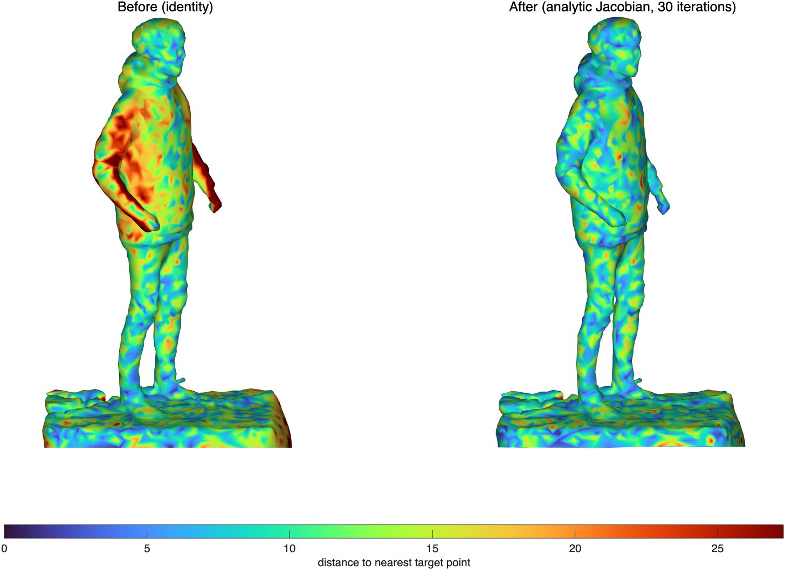

# ED_Jacobian

**Non-rigid mesh registration with embedded deformation and an analytic sparse Jacobian, as a step-by-step MATLAB tutorial.**

**Embedded deformation 기반 비강체 메쉬 정합과 해석적 sparse Jacobian을 단계별로 따라가는 MATLAB 튜토리얼.**



## What this is / 소개

**EN** — Given a source triangle mesh and a target mesh of the same object in a different pose, the code deforms the source onto the target. The deformation is an embedded deformation graph (Sumner et al., 2007): a sparse set of nodes on the surface, each with a local affine transform, blended over the vertices. Registration is a nonlinear least-squares problem, and the focus of this repository is its Jacobian: deriving it by hand, assembling it as a sparse matrix, verifying it against finite differences, and using it in several optimisers.

The method works on any triangle mesh. It was developed on human body scans, and the sample data are two frames of a clothed person.

**KO** — 소스 삼각 메쉬와, 같은 대상을 다른 자세로 담은 타깃 메쉬가 주어지면 소스를 타깃에 맞게 변형합니다. 변형 모델은 embedded deformation graph(Sumner 외, 2007)입니다. 표면 위에 노드를 드문드문 두고, 노드마다 국소 affine 변환을 주어 정점에 블렌딩합니다. 정합은 비선형 최소제곱 문제이고, 이 저장소의 초점은 그 Jacobian입니다. 손으로 유도하고, sparse 행렬로 조립하고, 유한차분으로 검증하고, 여러 최적화기에서 사용합니다.

이 방법은 삼각 메쉬라면 어디에나 쓸 수 있습니다. 사람 전신 스캔을 대상으로 개발했고, 샘플 데이터는 옷을 입은 사람의 두 프레임입니다.

## Tutorial / 튜토리얼

| # | Chapter / 장 | Script | Topic / 내용 |
|---|---|---|---|
| 0 | [Setup / 환경 준비](docs/00_setup.md) | — | requirements, layout, data / 요구 사항, 구조, 데이터 |
| 1 | [ED model / ED 모델](docs/01_ed_model.md) | [t01](tutorials/t01_ed_model.m) | nodes, weights, parameter vector / 노드, 가중치, 파라미터 벡터 |
| 2 | [Energy / 에너지](docs/02_energy.md) | [t02](tutorials/t02_energy.m) | the five residual terms, baseline without a Jacobian / 잔차 항 다섯 개, Jacobian 없는 기준 실행 |
| 3 | [Jacobian](docs/03_jacobian.md) | [t03](tutorials/t03_jacobian.m) | derivation and sparse assembly / 유도와 sparse 조립 |
| 4 | [Checking the Jacobian / Jacobian 검증](docs/04_jacobian_check.md) | [t04](tutorials/t04_jacobian_check.m) | finite-difference test, step size / 유한차분 검증, 스텝 크기 |
| 5 | [Solvers / 솔버](docs/05_solvers.md) | [t05](tutorials/t05_solvers.m) | gradient descent, Gauss-Newton, LM, CG / 직접 구현한 최적화기 비교 |
| 6 | [Performance / 성능](docs/06_performance.md) | [t06](tutorials/t06_performance.m) | analytic vs finite differences, scaling / 해석적 vs 유한차분, 규모 변화 |

**EN** — Each chapter pairs a document with a script that runs on the included data and regenerates the chapter's figures. The chapters build on each other; start at 0.

**KO** — 장마다 문서 하나와 스크립트 하나가 짝을 이룹니다. 스크립트는 포함된 데이터로 실행되고 그 장의 그림을 다시 만듭니다. 장들은 앞 장을 전제로 하므로 0장부터 읽으세요.

## Quick start / 빠른 시작

```matlab
src = edreg.loadMesh('data/human_020_f10k.ply');
tgt = edreg.loadMesh('data/human_022_f10k.ply');

model = edreg.buildModel(src.V, src.F, Seed=1);    % ED graph on the source / 소스 위에 ED 그래프 구성
[P, out] = edreg.register(model, tgt);             % lsqnonlin + analytic Jacobian

edreg.showMeshes({struct('V', out.Vd, 'F', src.F), tgt});
```

```matlab
run_all_tutorials          % all six chapters / 여섯 장 전체
runtests('tests')          % unit tests / 단위 테스트
```

**EN** — Needs MATLAB with the Optimization Toolbox and the Computer Vision Toolbox. No GPU is required. Details in [Setup](docs/00_setup.md).

**KO** — MATLAB과 Optimization Toolbox, Computer Vision Toolbox가 필요합니다. GPU는 필요 없습니다. 자세한 내용은 [환경 준비](docs/00_setup.md)에 있습니다.

## Results on the sample pair / 샘플 쌍 결과

**EN** — 5,027 source vertices, 50 nodes, 606 parameters, 30 iterations. Measured on an Apple Silicon CPU with MATLAB R2026b; timings vary by machine and run.

**KO** — 소스 정점 5,027개, 노드 50개, 파라미터 606개, 30회 반복. Apple Silicon CPU, MATLAB R2026b에서 측정했고, 시간은 장비와 실행에 따라 달라집니다.

| | |
|---|---|
| Cost $\lVert F \rVert^2$ / 비용 | 279.68 → 151.39 (`lsqnonlin`), 150.25 (LM-PCG) |
| Mean distance to target / 타깃까지 평균 거리 | 13.82 mm → 9.85 mm |
| 95th percentile distance / 95퍼센타일 거리 | 27.30 mm → 18.29 mm |
| Analytic vs finite-difference Jacobian / 해석적 vs 유한차분 Jacobian | 0.042 s vs 0.71 s (17×); 89× with 201 nodes (estimated) / 노드 201개에서는 89배 (추정) |
| Agreement with finite differences / 유한차분과의 일치 | relative error below 2e-8 on every non-zero block / 0이 아닌 모든 블록에서 상대 오차 2e-8 미만 |
| 30 iterations / 30회 반복 | 2.3 s (hand-written LM / 직접 구현한 LM), 15 s (`lsqnonlin`) |

**EN** — Fifty nodes give a coarse fit; the remaining error is spread evenly over the surface. More nodes (`SampleRate`) fit finer detail, and the analytic Jacobian is what keeps that affordable ([chapter 6](docs/06_performance.md)).

**KO** — 노드 50개로는 성긴 정합입니다. 남은 오차는 표면 전체에 고르게 퍼져 있습니다. 노드를 늘리면(`SampleRate`) 더 세밀하게 맞출 수 있고, 그 비용을 감당할 수 있게 해 주는 것이 해석적 Jacobian입니다([6장](docs/06_performance.md)).

## Layout / 구조

```
+edreg/            library / 라이브러리
  +solvers/        hand-written optimisers / 직접 구현한 최적화기
+jwutils/          mesh I/O and display helpers / 메쉬 입출력·표시 보조 함수
tutorials/         t01 ... t06
docs/              tutorial text / 튜토리얼 문서
data/              sample meshes / 샘플 메쉬
results/figures/   figures written by the tutorials / 튜토리얼이 만든 그림
tests/             unit tests / 단위 테스트
```

## About the original scripts / 원본 스크립트에 대해

**EN** — This repository began as about thirty experiment scripts (`EDRegisterSparse3*.m`, `simple_ver_*.m`, `*_hjh.m`, …), each a copy of the previous one with one thing changed. They have been consolidated into the `+edreg` package and removed; they remain in the git history. The energy is unchanged. The Jacobian was corrected in three places found by the finite-difference check (see [chapter 3](docs/03_jacobian.md#36-differences-from-the-original-scripts--원본-스크립트와의-차이)), and the GPU, Statistics Toolbox and mexopencv dependencies were removed.

**KO** — 이 저장소는 실험 스크립트 서른 개 정도(`EDRegisterSparse3*.m`, `simple_ver_*.m`, `*_hjh.m` 등)에서 출발했습니다. 각 스크립트는 앞의 것을 복사해 한 가지만 바꾼 형태였습니다. 이들을 `+edreg` 패키지로 통합하고 삭제했으며, git 히스토리에는 남아 있습니다. 에너지는 그대로입니다. Jacobian은 유한차분 검증에서 찾은 세 군데를 고쳤고([3장](docs/03_jacobian.md#36-differences-from-the-original-scripts--원본-스크립트와의-차이) 참고), GPU·Statistics Toolbox·mexopencv 의존성을 없앴습니다.

## Reference / 참고 문헌

R. W. Sumner, J. Schmid, M. Pauly. *Embedded Deformation for Shape Manipulation.* ACM SIGGRAPH 2007.
