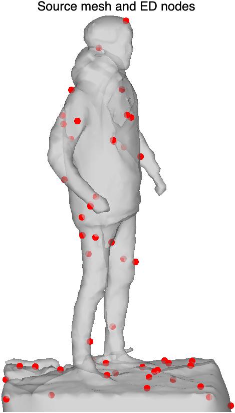
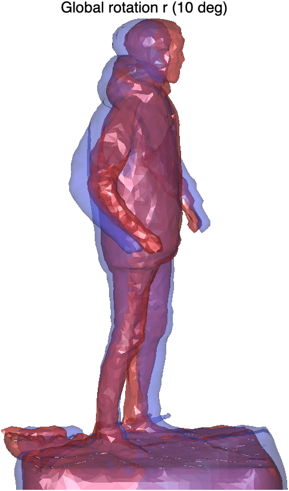
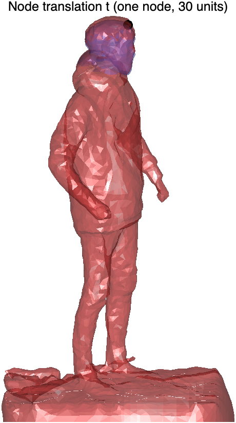
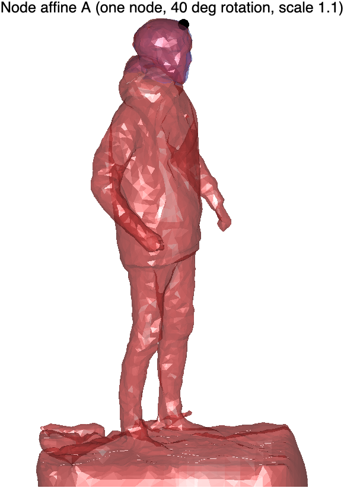

# 1. The embedded deformation model / ED 모델

[← Setup](00_setup.md) | [Next: Energy →](02_energy.md)

**Script / 스크립트:** [tutorials/t01_ed_model.m](../tutorials/t01_ed_model.m)
**Code / 코드:** [buildModel.m](../+edreg/buildModel.m), [deform.m](../+edreg/deform.m), [encodeParam.m](../+edreg/encodeParam.m), [decodeParam.m](../+edreg/decodeParam.m), [rodrigues.m](../+edreg/rodrigues.m)

## Goal / 목표

**EN** — Understand what is being optimised: the parameter vector `P`, how it moves the vertices of the source mesh, and how the deformation graph is built.

**KO** — 무엇을 최적화하는지 이해합니다. 파라미터 벡터 `P`가 무엇이고, 소스 메쉬의 정점을 어떻게 움직이며, 변형 그래프를 어떻게 만드는지 다룹니다.

## 1.1 Idea / 아이디어

**EN** — Moving every vertex independently gives far too many unknowns and no notion of a "reasonable" deformation. Embedded deformation (Sumner, Schmid, Pauly, *Embedded Deformation for Shape Manipulation*, SIGGRAPH 2007) instead attaches a small set of **nodes** to the surface. Each node carries a local affine transform, and each vertex follows a weighted blend of the nodes near it. The method needs only a triangle mesh, so it applies to any shape; the sample data here are human body scans.

**KO** — 정점을 하나씩 따로 움직이면 미지수가 너무 많고 "그럴듯한 변형"이라는 개념도 없습니다. Embedded deformation(Sumner 외, SIGGRAPH 2007)은 표면 위에 소수의 **노드**를 두고, 노드마다 국소 affine 변환을 줍니다. 각 정점은 가까운 노드들의 변환을 가중 평균해서 따라갑니다. 삼각 메쉬만 있으면 되므로 어떤 형상에도 쓸 수 있고, 여기 샘플 데이터는 사람 전신 스캔입니다.



## 1.2 Deformation / 변형 식

**EN** — Node $k$ sits at $g_k$ (a source vertex) and has a $3\times3$ matrix $A_k$ and a translation $t_k$. Vertex $v_i$ is influenced by its $K$ nearest nodes with weights $w_{ik}$:

**KO** — 노드 $k$는 위치 $g_k$(소스 정점 중 하나)에 있고 $3\times3$ 행렬 $A_k$와 이동 $t_k$를 가집니다. 정점 $v_i$는 가장 가까운 노드 $K$개의 영향을 가중치 $w_{ik}$로 받습니다.

$$\tilde v_i = \sum_{k \in \mathcal N(i)} w_{ik}\,\bigl[A_k (v_i - g_k) + g_k + t_k\bigr]$$

**EN** — A global rigid motion (rotation $R$ about the source centroid $c$, translation $T$) is applied on top:

**KO** — 그 위에 전역 강체 운동(소스 무게중심 $c$를 중심으로 한 회전 $R$, 이동 $T$)을 적용합니다.

$$v'_i = R\,(\tilde v_i - c) + c + T$$

**EN** — $R$ is parameterised by a rotation vector $r$ (axis × angle), $R = \exp([r]_\times)$, computed by `edreg.rodrigues`.

**KO** — $R$은 회전 벡터 $r$(축 × 각도)로 표현하며 $R = \exp([r]_\times)$입니다. `edreg.rodrigues`가 계산합니다.

## 1.3 Parameter vector / 파라미터 벡터

**EN** — Everything is packed into one column vector. With $N$ nodes it has $6 + 12N$ entries; the sample mesh (5,027 vertices, 1% sampling) gives $N = 50$ and 606 parameters.

**KO** — 모든 미지수를 열 벡터 하나에 담습니다. 노드가 $N$개면 길이는 $6 + 12N$이고, 샘플 메쉬(정점 5,027개, 1% 샘플링)에서는 $N = 50$, 파라미터 606개입니다.

| Block | Indices | Size | Meaning / 의미 |
|---|---|---|---|
| `r` | `1:3` | 3 | global rotation vector / 전역 회전 벡터 |
| `T` | `4:6` | 3 | global translation / 전역 이동 |
| `A` | `7 : 6+9N` | 9N | node matrices, column-major per node / 노드 행렬 (노드별 column-major) |
| `t` | `7+9N : 6+12N` | 3N | node translations / 노드 이동 |

```matlab
P0 = edreg.identityParam(N);              % r = 0, T = 0, A_k = I, t_k = 0
[R, T, A, t] = edreg.decodeParam(P, N);   % A is 3x3xN, t is 3xN
P = edreg.encodeParam(R, T, A, t);
```

## 1.4 Building the graph / 그래프 구성

**EN** — `edreg.buildModel(V, F)` does the following once, before optimisation:

1. **Nodes** — sample `round(n * SampleRate)` vertices at random (`Seed` makes it reproducible).
2. **Geodesic distance** — build a graph from the mesh edges, weighted by edge length, and compute shortest-path distances from every node to every vertex. Distances follow the surface, so a hand near the hip is not pulled by hip nodes.
3. **Vertex weights** — for each vertex take the $K+1$ nearest nodes with distances $d_1 \le \dots \le d_{K+1}$ and set $w_{ik} \propto 1 - d_k / d_{K+1}$, normalised to sum to 1. The $(K+1)$-th node only sets the scale and gets zero weight.
4. **Node neighbours** — each node's `NumNodeNeighbors` nearest nodes (itself first), used by the smoothness term.
5. **Laplacian** — the graph Laplacian of the same edge-length-weighted graph, used by the Laplacian term.

**KO** — `edreg.buildModel(V, F)`는 최적화 전에 한 번 다음을 수행합니다.

1. **노드** — 정점 중 `round(n * SampleRate)`개를 무작위로 뽑습니다(`Seed`로 재현 가능).
2. **측지 거리** — 메쉬 edge로 그래프를 만들고 edge 길이를 가중치로 해서, 모든 노드에서 모든 정점까지의 최단 경로 거리를 구합니다. 거리가 표면을 따라가므로 골반 옆에 있는 손이 골반 노드에 끌려가지 않습니다.
3. **정점 가중치** — 정점마다 가장 가까운 노드 $K+1$개의 거리 $d_1 \le \dots \le d_{K+1}$를 구해 $w_{ik} \propto 1 - d_k / d_{K+1}$로 두고 합이 1이 되게 정규화합니다. $(K+1)$번째 노드는 스케일만 정하고 가중치는 0입니다.
4. **노드 이웃** — 노드마다 가장 가까운 노드 `NumNodeNeighbors`개(자기 자신이 첫 번째). smoothness 항에서 씁니다.
5. **Laplacian** — 같은 그래프의 graph Laplacian. Laplacian 항에서 씁니다.

| Option | Default | Meaning / 의미 |
|---|---|---|
| `SampleRate` | 0.01 | fraction of vertices used as nodes / 노드로 쓰는 정점 비율 |
| `NumVertexNeighbors` | 4 | $K$, nodes per vertex / 정점당 노드 수 |
| `NumNodeNeighbors` | 6 | neighbours per node, including itself / 노드당 이웃 수 (자신 포함) |
| `Seed` | — | fixes the node sampling / 노드 샘플링 고정 |

**EN** — **Invalid vertices.** A vertex with no reachable node (a disconnected fragment of the scan) has undefined weights. It is flagged in `model.invalidVertex` and kept at its original position. The sample source mesh has 9 such vertices.

**KO** — **유효하지 않은 정점.** 도달 가능한 노드가 없는 정점(스캔에서 떨어져 나온 조각)은 가중치를 정의할 수 없습니다. `model.invalidVertex`에 표시하고 원래 위치에 그대로 둡니다. 샘플 소스 메쉬에는 이런 정점이 9개 있습니다.

## 1.5 What each block does / 각 블록의 효과

**EN** — `t01` applies three hand-made parameter changes. Blue is the source, red the deformed mesh.

**KO** — `t01`은 파라미터를 손으로 세 가지 방식으로 바꿔 봅니다. 파란색이 소스, 빨간색이 변형된 메쉬입니다.

| Global rotation `r` (10°) | One node translation `t_k` | One node affine `A_k` (40°, ×1.1) |
|---|---|---|
|  |  |  |

**EN** — Moving one node only moves the vertices that have it among their $K$ neighbours, and `A_k` rotates and scales about $g_k$, so the node position itself stays put. This locality is what makes the Jacobian sparse in [chapter 3](03_jacobian.md).

**KO** — 노드 하나를 움직이면 그 노드를 $K$개 이웃 안에 가진 정점만 움직입니다. `A_k`는 $g_k$를 중심으로 회전·스케일하므로 노드 위치 자체는 그대로입니다. 이 국소성 때문에 [3장](03_jacobian.md)의 Jacobian이 sparse해집니다.

## Run / 실행

```matlab
run('tutorials/t01_ed_model.m')
```

[Next: Energy / 다음: 에너지 →](02_energy.md)
