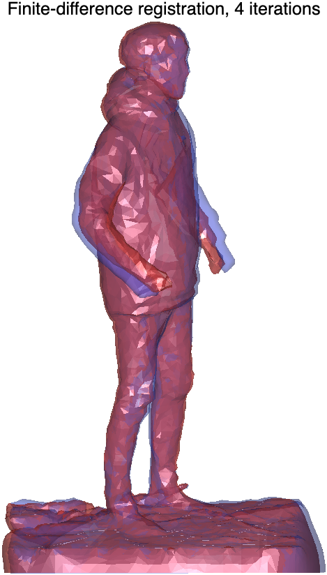

# 2. Energy terms / 에너지 항

[← ED model](01_ed_model.md) | [Next: Jacobian →](03_jacobian.md)

**Script / 스크립트:** [tutorials/t02_energy.m](../tutorials/t02_energy.m)
**Code / 코드:** [residual.m](../+edreg/residual.m), [findCorrespondence.m](../+edreg/findCorrespondence.m), [register.m](../+edreg/register.m), [defaultWeights.m](../+edreg/defaultWeights.m)

## Goal / 목표

**EN** — Define the cost that registration minimises, see how large each term is before optimisation, and run the baseline that uses no analytic Jacobian.

**KO** — 정합이 최소화하는 비용을 정의하고, 최적화 전에 각 항이 얼마나 큰지 확인한 뒤, 해석적 Jacobian 없이 도는 기준 실행을 해 봅니다.

## 2.1 Nonlinear least squares / 비선형 최소제곱

**EN** — Registration is posed as $\min_P \lVert F(P) \rVert^2$, where $F$ stacks five residual blocks. `edreg.residual` returns $F$ (and optionally $J = \partial F / \partial P$):

**KO** — 정합은 $\min_P \lVert F(P) \rVert^2$ 문제이고, $F$는 잔차 블록 다섯 개를 쌓은 벡터입니다. `edreg.residual`이 $F$를 (필요하면 $J = \partial F / \partial P$도) 반환합니다.

$$F = \bigl[\,E_{fit};\ \ w_{rot}E_{rot1};\ \ w_{rot}E_{rot2};\ \ w_{smooth}E_{smooth};\ \ w_{lap}E_{lap}\,\bigr]$$

```matlab
w = edreg.defaultWeights();                       % rot = 1.0, smooth = 0.1, lap = 0.01
[F, J, info] = edreg.residual(P, model, target, w);
info.rows.fit      % row range of each term / 항별 행 범위
info.cols.A        % column range of each parameter block / 파라미터 블록별 열 범위
```

## 2.2 The five terms / 다섯 개 항

**EN** — $n$ is the number of source vertices, $n_T$ target vertices, $N$ nodes, $V'$ the deformed source vertices ($n \times 3$).

**KO** — $n$은 소스 정점 수, $n_T$는 타깃 정점 수, $N$은 노드 수, $V'$는 변형된 소스 정점($n \times 3$)입니다.

### Fit / 정합

$$E_{fit,q} = \frac{v'_{c(q)} - p_q}{\sqrt{n_T}}, \qquad c(q) = \arg\min_i \lVert v'_i - p_q \rVert$$

**EN** — For every target point $p_q$, the nearest deformed source vertex is pulled towards it. The correspondence $c(q)$ is recomputed whenever the residual is evaluated, as in ICP. Size $3 n_T$.

**KO** — 타깃 점 $p_q$마다 가장 가까운 변형된 소스 정점을 그쪽으로 당깁니다. 대응 $c(q)$는 ICP처럼 잔차를 계산할 때마다 다시 구합니다. 크기는 $3 n_T$입니다.

### Rotation / 회전

$$E_{rot1,k} = \frac{A_k^\top A_k - I}{\sqrt N}, \qquad E_{rot2,k} = \frac{\det A_k - 1}{\sqrt N}$$

**EN** — Keeps each $A_k$ close to a proper rotation: orthonormal columns, determinant $+1$. Without it the nodes would shear and scale freely. Sizes $9N$ and $N$.

**KO** — 각 $A_k$를 회전 행렬에 가깝게 유지합니다(열이 정규직교, 행렬식 $+1$). 이 항이 없으면 노드가 마음대로 전단·스케일됩니다. 크기는 $9N$과 $N$입니다.

### Smoothness / 평활

$$E_{smooth,k} = \frac{1}{\sqrt{3N}} \sum_{j \in \mathcal N(k)} \bigl[A_k (g_j - g_k) + g_k + t_k - (g_j + t_j)\bigr]$$

**EN** — Node $k$ predicts where its neighbour $j$ should go; the bracket is the gap between that prediction and where $j$ actually goes. Note that this code sums the gaps over the neighbours *before* squaring, giving one 3-vector per node (size $3N$), rather than one residual per edge as in the original paper.

**KO** — 노드 $k$가 이웃 $j$의 이동 위치를 예측하고, 괄호 안은 그 예측과 $j$의 실제 위치 사이의 차이입니다. 이 코드는 이웃에 대해 차이를 *먼저 더한 뒤* 제곱하므로 노드당 3차원 벡터 하나(크기 $3N$)가 됩니다. 원 논문처럼 edge마다 잔차를 두는 방식과는 다릅니다.

### Laplacian

$$E_{lap} = D^{-1} L\, V', \qquad D = \mathrm{diag}(L)$$

**EN** — $L$ is the graph Laplacian of the source mesh, so each row is the offset of a deformed vertex from the weighted mean of its neighbours. It penalises bumpy results. Size $3n$.

**KO** — $L$은 소스 메쉬의 graph Laplacian이라서, 각 행은 변형된 정점이 이웃의 가중 평균에서 벗어난 정도입니다. 울퉁불퉁한 결과를 억제합니다. 크기는 $3n$입니다.

## 2.3 At the identity / 초기 상태에서

**EN** — For the sample pair ($n = 5027$, $n_T = 5033$, $N = 50$) the residual has 30,830 rows: fit 15,099, rot1 450, rot2 50, smooth 150, lap 15,081. At the identity the rotation and smoothness terms are exactly zero; fit and Laplacian are not. The Laplacian term is non-zero even for the undeformed mesh because it penalises $L V'$ itself, not its change from the source. The starting cost is $\lVert F \rVert^2 = 279.68$.

**KO** — 샘플 쌍($n = 5027$, $n_T = 5033$, $N = 50$)에서 잔차는 30,830행입니다(fit 15,099, rot1 450, rot2 50, smooth 150, lap 15,081). 초기 상태에서 회전·평활 항은 정확히 0이고 fit과 Laplacian은 0이 아닙니다. Laplacian 항은 소스 대비 변화량이 아니라 $L V'$ 자체를 벌점으로 주기 때문에, 변형하지 않은 메쉬에서도 0이 아닙니다. 시작 비용은 $\lVert F \rVert^2 = 279.68$입니다.

## 2.4 Baseline without a Jacobian / Jacobian 없는 기준 실행

```matlab
[P, out] = edreg.register(model, target, UseJacobian=false, MaxIterations=3);
```

**EN** — `edreg.register` wraps `lsqnonlin`. With `UseJacobian=false`, MATLAB estimates $J$ by finite differences, which costs one residual evaluation per parameter: 606 evaluations per iteration here. The tutorial caps the run at 3 iterations for that reason; it needs 3,035 residual evaluations (about 8 s here), and lowers the cost only from 279.68 to 270.44.

This is the motivation for the next chapter: the number of parameters grows with the number of nodes, and so does the cost of every finite-difference Jacobian.

**KO** — `edreg.register`는 `lsqnonlin`을 감싼 함수입니다. `UseJacobian=false`이면 MATLAB이 유한차분으로 $J$를 추정하는데, 파라미터 하나당 잔차 계산이 한 번 필요합니다. 여기서는 반복마다 606번입니다. 그래서 튜토리얼은 3회 반복으로 제한했고, 잔차 계산 3,035번(여기서는 약 8초)을 써서 비용을 279.68에서 270.44로밖에 못 낮춥니다.

이것이 다음 장의 동기입니다. 파라미터 수는 노드 수에 비례해 늘고, 유한차분 Jacobian 한 번의 비용도 같이 늘어납니다.



## Run / 실행

```matlab
run('tutorials/t02_energy.m')
```

[Next: Jacobian / 다음: Jacobian →](03_jacobian.md)
