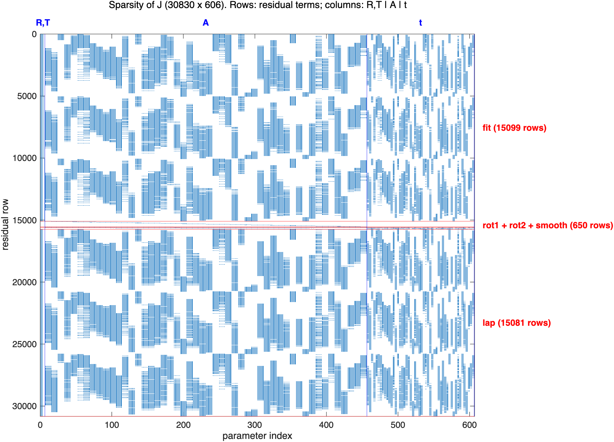
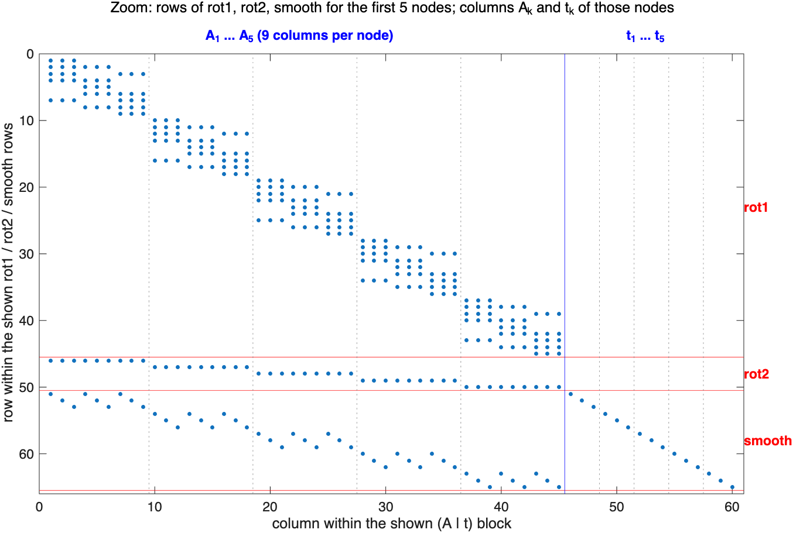
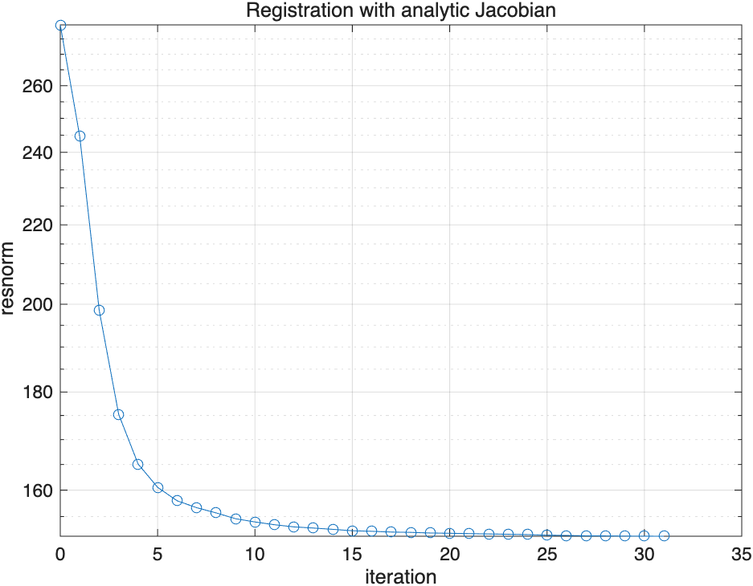
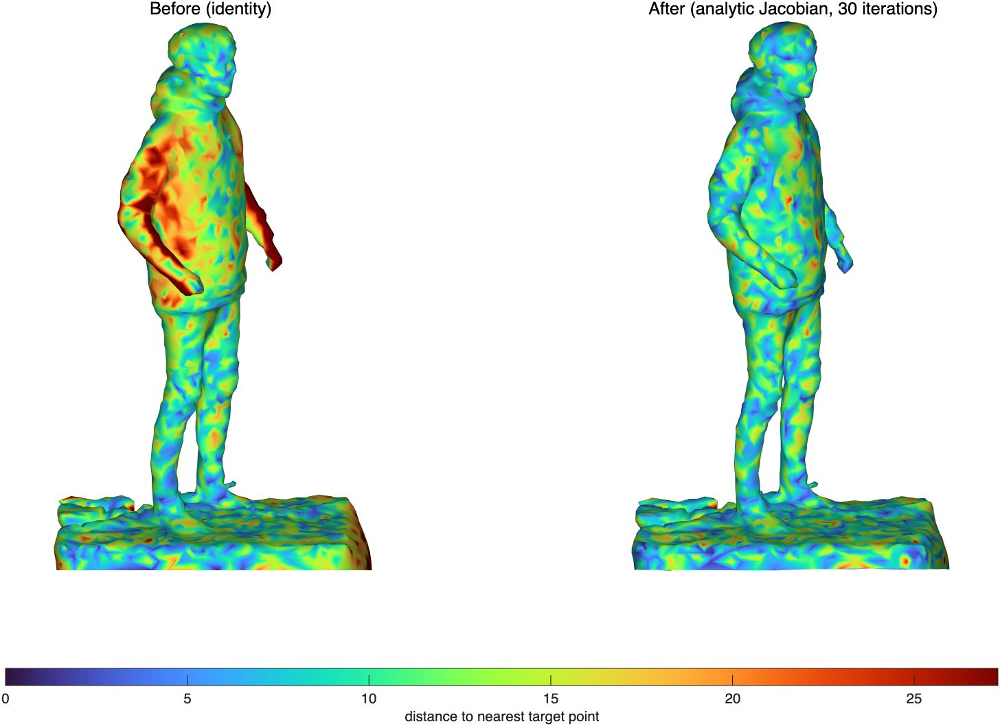

# 3. The analytic Jacobian / 해석적 Jacobian

[← Energy](02_energy.md) | [Next: Checking the Jacobian →](04_jacobian_check.md)

**Script / 스크립트:** [tutorials/t03_jacobian.m](../tutorials/t03_jacobian.m)
**Code / 코드:** [residual.m](../+edreg/residual.m) (`deformJacobian`, `jacFit`, `jacRot1`, `jacRot2`, `jacSmooth`, `jacLap`), [rodrigues.m](../+edreg/rodrigues.m)

## Goal / 목표

**EN** — Derive $J = \partial F / \partial P$ term by term, see how it is assembled as a sparse matrix, and measure what it buys.

**KO** — $J = \partial F / \partial P$를 항별로 유도하고, sparse 행렬로 조립하는 방법을 본 뒤, 그 효과를 측정합니다.

## 3.1 Structure / 구조

**EN** — $J$ has one row per residual and one column per parameter (30,830 × 606 for the sample pair). The columns are ordered `[r | T | A | t]` as in `P`. Which blocks can be non-zero follows directly from which parameters each term depends on:

**KO** — $J$는 잔차마다 한 행, 파라미터마다 한 열을 가집니다(샘플 쌍에서 30,830 × 606). 열 순서는 `P`와 같은 `[r | T | A | t]`입니다. 어느 블록이 0이 아닐 수 있는지는 각 항이 어떤 파라미터에 의존하는지에서 바로 나옵니다.

| Term | `r` | `T` | `A` | `t` |
|---|---|---|---|---|
| fit | ● | ● | ● | ● |
| rot1 | | | ● | |
| rot2 | | | ● | |
| smooth | | | ● | ● |
| lap | ● | (0)* | ● | ● |

**EN** — \* The Laplacian rows sum to zero, so a global translation cancels. The block is exactly zero unless the mesh has pinned (invalid) vertices.

**KO** — \* Laplacian의 각 행은 합이 0이라 전역 이동은 상쇄됩니다. 고정된(유효하지 않은) 정점이 없으면 이 블록은 정확히 0입니다.





## 3.2 Shared block: derivative of the deformed vertices / 공용 블록: 변형 정점의 미분

**EN** — Fit and Laplacian both depend on $P$ only through the deformed vertices, so `deformJacobian` computes $\partial V' / \partial P$ ($3n \times (6+12N)$) once. Recall

**KO** — fit과 Laplacian은 변형된 정점을 통해서만 $P$에 의존하므로, `deformJacobian`이 $\partial V' / \partial P$ ($3n \times (6+12N)$)를 한 번 계산해 둡니다. 변형 식은 다음과 같았습니다.

$$u_i = \sum_k w_{ik}\,[A_k (v_i - g_k) + g_k + t_k] - c, \qquad v'_i = R\,u_i + c + T$$

**EN** — Writing $v'_{i,a}$ for coordinate $a$ of vertex $i$:

**KO** — 정점 $i$의 좌표 $a$를 $v'_{i,a}$로 쓰면:

| With respect to / 미분 변수 | Derivative / 미분값 |
|---|---|
| $R_{ab}$ | $u_{i,b}$ |
| $T_a$ | $1$ |
| $(A_k)_{bc}$ | $w_{ik}\,R_{ab}\,(v_i - g_k)_c$ |
| $(t_k)_b$ | $w_{ik}\,R_{ab}$ |

**EN** — The last two are non-zero only when node $k$ is one of the $K$ neighbours of vertex $i$. That is the source of sparsity: each vertex row touches $12K$ of the $12N$ node columns (8% for $K = 4$, $N = 50$, and less as $N$ grows).

**KO** — 아래 두 줄은 노드 $k$가 정점 $i$의 이웃 $K$개 중 하나일 때만 0이 아닙니다. 이것이 sparsity의 원인입니다. 정점 행 하나는 노드 열 $12N$개 중 $12K$개만 건드립니다($K = 4$, $N = 50$이면 8%, $N$이 커질수록 더 작아집니다).

### Rotation vector / 회전 벡터

**EN** — The optimiser works with the rotation vector $r$, not with $R$, so the $R$ block is chained with $\partial\,\mathrm{vec}(R) / \partial r$ (a $9 \times 3$ matrix). With $\theta = \lVert r \rVert$, $K = [r]_\times$, $a = \sin\theta/\theta$, $b = (1-\cos\theta)/\theta^2$:

**KO** — 최적화 변수는 $R$이 아니라 회전 벡터 $r$이므로, $R$ 블록에 $\partial\,\mathrm{vec}(R) / \partial r$ ($9 \times 3$ 행렬)을 곱해 연쇄법칙을 적용합니다. $\theta = \lVert r \rVert$, $K = [r]_\times$, $a = \sin\theta/\theta$, $b = (1-\cos\theta)/\theta^2$로 두면:

$$R = I + aK + bK^2, \qquad \frac{\partial R}{\partial r_i} = aK_i + b\,(K_i K + K K_i) + r_i\left(\frac{a'}{\theta}K + \frac{b'}{\theta}K^2\right), \quad K_i = [e_i]_\times$$

**EN** — The optimisation starts at $r = 0$, where these coefficients are $0/0$. `edreg.rodrigues` switches to Taylor series for $\theta < 10^{-2}$, which gives $\partial R / \partial r_i = [e_i]_\times$ exactly at zero.

**KO** — 최적화는 $r = 0$에서 시작하는데, 이때 위 계수들은 $0/0$ 꼴입니다. `edreg.rodrigues`는 $\theta < 10^{-2}$에서 Taylor 급수로 전환하며, 0에서는 정확히 $\partial R / \partial r_i = [e_i]_\times$가 됩니다.

## 3.3 Term by term / 항별 유도

### Fit — `jacFit`

**EN** — $E_{fit,q} = (v'_{c(q)} - p_q)/\sqrt{n_T}$ with the correspondence $c(q)$ held fixed, so the Jacobian is just a row selection of the shared block:

**KO** — $E_{fit,q} = (v'_{c(q)} - p_q)/\sqrt{n_T}$에서 대응 $c(q)$를 고정하면, Jacobian은 공용 블록에서 행을 골라낸 것입니다.

```matlab
rows = [corr; n + corr; 2*n + corr];
Jf = dV(rows, :) / sqrt(nT);
```

### Laplacian — `jacLap`

**EN** — $E_{lap} = D^{-1} L V'$ is linear in $V'$, so $J_{lap} = (I_3 \otimes D^{-1}L)\,\partial V'/\partial P$: apply the Laplacian to the x, y and z row groups of the shared block.

**KO** — $E_{lap} = D^{-1} L V'$는 $V'$에 대해 선형이므로 $J_{lap} = (I_3 \otimes D^{-1}L)\,\partial V'/\partial P$입니다. 공용 블록의 x, y, z 행 묶음 각각에 Laplacian을 적용합니다.

### Rotation 1 — `jacRot1`

**EN** — $(A^\top A)_{pq} = \sum_r A_{rp} A_{rq}$, so

**KO** — $(A^\top A)_{pq} = \sum_r A_{rp} A_{rq}$이므로

$$\frac{\partial (A^\top A)_{pq}}{\partial A_{rs}} = \delta_{sp}\,A_{rq} + \delta_{sq}\,A_{rp}$$

**EN** — Each node contributes an independent $9 \times 9$ block on the diagonal of the `A` columns.

**KO** — 노드마다 `A` 열의 대각선 위에 독립적인 $9 \times 9$ 블록이 하나씩 생깁니다.

### Rotation 2 — `jacRot2`

**EN** — The derivative of a determinant is the cofactor matrix. For $A = [a_1\ a_2\ a_3]$ its columns are cross products:

**KO** — 행렬식의 미분은 여인수 행렬입니다. $A = [a_1\ a_2\ a_3]$이면 그 열은 외적으로 쓸 수 있습니다.

$$\frac{\partial \det A}{\partial A} = [\,a_2 \times a_3 \quad a_3 \times a_1 \quad a_1 \times a_2\,]$$

### Smoothness — `jacSmooth`

**EN** — With $s_k = \sum_{j \in \mathcal N(k)} (g_j - g_k)$ and $K_n$ neighbours per node:

**KO** — $s_k = \sum_{j \in \mathcal N(k)} (g_j - g_k)$, 노드당 이웃 수를 $K_n$이라 하면:

$$\frac{\partial E_{smooth,k,a}}{\partial (A_k)_{ab}} = \frac{(s_k)_b}{\sqrt{3N}}, \qquad \frac{\partial E_{smooth,k}}{\partial t_k} = \frac{K_n}{\sqrt{3N}} I, \qquad \frac{\partial E_{smooth,k}}{\partial t_j} = -\frac{1}{\sqrt{3N}} I$$

**EN** — The node is its own first neighbour, so the $+K_n$ and one $-1$ land on the same column and the net diagonal is $K_n - 1$. This block does not depend on $P$ at all: the smoothness term is linear.

**KO** — 노드는 자기 자신의 첫 번째 이웃이므로 $+K_n$과 $-1$ 하나가 같은 열에 들어가 대각 성분은 결국 $K_n - 1$입니다. 이 블록은 $P$에 전혀 의존하지 않습니다. smoothness 항이 선형이기 때문입니다.

## 3.4 Assembly / 조립

**EN** — Every block is built from index/value triplets with one `sparse(i, j, v, m, n)` call, with no loops over vertices. The triplet arrays are generated by broadcasting over the dimensions (vertex, neighbour slot, matrix row, matrix column, output coordinate). The final matrix is a vertical stack scaled by the weights:

**KO** — 모든 블록은 인덱스·값 triplet을 만들어 `sparse(i, j, v, m, n)` 한 번으로 조립하며, 정점에 대한 루프가 없습니다. triplet 배열은 (정점, 이웃 슬롯, 행렬 행, 행렬 열, 출력 좌표) 차원으로 broadcasting해서 만듭니다. 최종 행렬은 가중치를 곱해 세로로 쌓은 것입니다.

```matlab
dV = deformJacobian(model, aux);
J = [ jacFit(dV, corr, n, nT);
      w.rot    * jacRot1(A, nP);
      w.rot    * jacRot2(A, nP);
      w.smooth * jacSmooth(model, nP);
      w.lap    * jacLap(dV, model) ];
```

## 3.5 What it buys / 효과

```matlab
[P, out] = edreg.register(model, target, UseJacobian=true, MaxIterations=30);
```

**EN** — Measured on the sample pair (Apple Silicon, CPU, MATLAB R2026b; your numbers will differ):

**KO** — 샘플 쌍에서 측정한 값입니다(Apple Silicon, CPU, MATLAB R2026b. 환경에 따라 달라집니다).

| | Finite differences / 유한차분 | Analytic / 해석적 |
|---|---|---|
| One Jacobian / Jacobian 1회 | 1.1 s | 0.06 s (incl. residual / 잔차 포함) |
| Per `lsqnonlin` iteration / 반복당 | 2.03 s | 0.50 s |
| 30-iteration run / 30회 반복 | not run / 실행 안 함 | 15 s, cost / 비용 279.68 → 151.39 |
| Mean distance to target / 타깃까지 평균 거리 | 13.82 → 13.70 mm (4 iterations / 4회) | 13.82 → 9.85 mm (31 iterations / 31회) |





**EN** — The two runs are not equivalent beyond cost per iteration. `lsqnonlin`'s finite differences also perturb the nearest-neighbour correspondences, while the analytic Jacobian holds them fixed within an iteration. Holding them fixed is the standard ICP treatment and is what makes the function differentiable.

**KO** — 두 실행은 반복당 비용 외에는 동등하지 않습니다. `lsqnonlin`의 유한차분은 최근접 대응까지 함께 흔들지만, 해석적 Jacobian은 한 반복 안에서 대응을 고정합니다. 대응을 고정하는 것이 ICP의 표준 처리이고, 그래야 함수가 미분 가능해집니다.

## 3.6 Differences from the original scripts / 원본 스크립트와의 차이

**EN** — The energy is identical to the original `EDRegisterSparse_Show_iter_Jall_FINAL.m` (the residual vectors agree to $5 \times 10^{-15}$). The Jacobian differs in three places, each confirmed against finite differences:

1. **`Jrot1`, `Jrot2` were transposed per node.** The values were laid out in row-major order of $A_k$ but written to column-major parameter columns. They were correct only for symmetric $A_k$, which includes the starting point $A_k = I$, so the error appeared only after the first steps.
2. **`Jlap` had no global-rotation columns.** The original set all six global columns to zero, but $L V'$ does depend on $R$. Only the translation columns vanish.
3. **Pinned vertices had non-zero rows.** Vertices without a reachable node are held in place, so their rows must be zero.

The smoothness block also used `n_vertex_neighbor - 1` where the matrix dimension 3 was meant; the two coincide for the default $K = 4$.

**KO** — 에너지는 원본 `EDRegisterSparse_Show_iter_Jall_FINAL.m`과 동일합니다(잔차 벡터가 $5 \times 10^{-15}$ 이내로 일치). Jacobian은 세 군데가 다르고, 모두 유한차분으로 확인했습니다.

1. **`Jrot1`, `Jrot2`가 노드별로 전치되어 있었습니다.** 값은 $A_k$의 row-major 순서로 만들고 column-major 파라미터 열에 써넣었습니다. $A_k$가 대칭일 때만 맞는데, 시작점 $A_k = I$가 여기에 해당해서 첫 몇 스텝 이후에야 오차가 나타났습니다.
2. **`Jlap`에 전역 회전 열이 없었습니다.** 원본은 전역 열 6개를 모두 0으로 뒀지만 $L V'$는 $R$에 의존합니다. 0이 되는 것은 이동 열뿐입니다.
3. **고정된 정점의 행이 0이 아니었습니다.** 도달 가능한 노드가 없는 정점은 제자리에 고정되므로 그 행은 0이어야 합니다.

smoothness 블록에서는 행렬 차원 3이 들어갈 자리에 `n_vertex_neighbor - 1`을 썼는데, 기본값 $K = 4$에서는 두 값이 같습니다.

## Run / 실행

```matlab
run('tutorials/t02_energy.m')    % writes the baseline timing t03 compares against
run('tutorials/t03_jacobian.m')
```

[Next: Checking the Jacobian / 다음: Jacobian 검증 →](04_jacobian_check.md)
