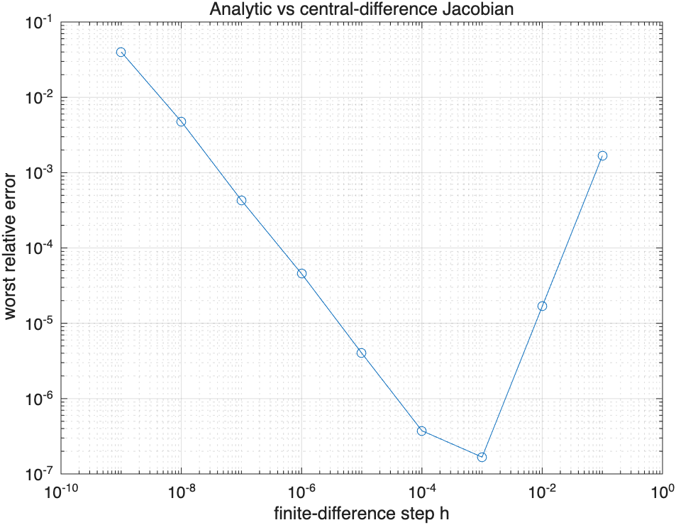
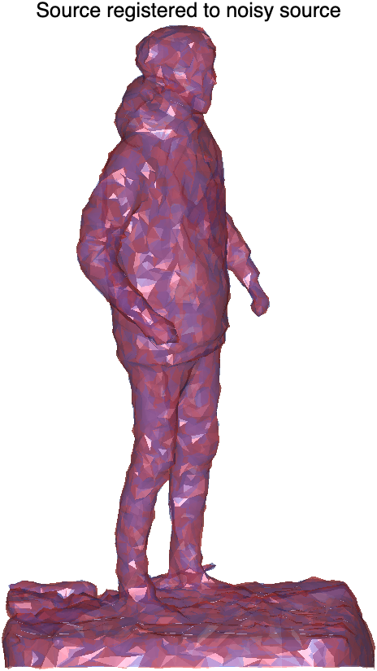

# 4. Checking the Jacobian / Jacobian 검증

[← Jacobian](03_jacobian.md) | [Next: Solvers →](05_solvers.md)

**Script / 스크립트:** [tutorials/t04_jacobian_check.m](../tutorials/t04_jacobian_check.m)
**Code / 코드:** [checkJacobian.m](../+edreg/checkJacobian.m), [numericJacobian.m](../+edreg/numericJacobian.m)

## Goal / 목표

**EN** — A hand-derived Jacobian is easy to get subtly wrong, and a wrong Jacobian often still converges, only worse. This chapter shows how to test it so that a mistake cannot hide.

**KO** — 손으로 유도한 Jacobian은 미묘하게 틀리기 쉽고, 틀린 Jacobian으로도 대개 수렴은 합니다. 다만 결과가 나빠질 뿐입니다. 이 장은 실수가 숨지 못하도록 검증하는 방법을 다룹니다.

## 4.1 Method / 방법

**EN** — Compare each analytic column with a central difference:

**KO** — 해석적 Jacobian의 각 열을 중앙차분과 비교합니다.

$$J_{:,j} \approx \frac{F(P + h e_j) - F(P - h e_j)}{2h}$$

```matlab
report = edreg.checkJacobian(P, model, target, w);              % all columns / 전체 열
report = edreg.checkJacobian(P, model, target, w, Columns=1:50, Step=1e-4);
```

**EN** — Three rules make the test meaningful:

1. **Fix the correspondences.** The nearest-neighbour assignment changes discontinuously with $P$. `checkJacobian` computes it once at $P$ and reuses it for every perturbed evaluation.
2. **Test away from the identity.** At $A_k = I$, $r = 0$ many errors vanish by symmetry. The transposed `Jrot` blocks of the original scripts pass at the identity and fail everywhere else.
3. **Report per block.** One global maximum hides a wrong small block behind a correct large one. The report has one row per (term, parameter block).

**KO** — 검증이 의미를 가지려면 세 가지를 지켜야 합니다.

1. **대응을 고정합니다.** 최근접 대응은 $P$에 따라 불연속적으로 바뀝니다. `checkJacobian`은 $P$에서 한 번 계산한 대응을 모든 섭동 계산에 재사용합니다.
2. **항등 변환이 아닌 점에서 검증합니다.** $A_k = I$, $r = 0$에서는 대칭성 때문에 많은 오류가 사라집니다. 원본 스크립트의 전치된 `Jrot` 블록은 항등 변환에서는 통과하고 그 밖의 모든 점에서 실패합니다.
3. **블록별로 보고합니다.** 전체 최댓값 하나만 보면, 틀린 작은 블록이 맞는 큰 블록 뒤에 숨습니다. 보고서는 (항, 파라미터 블록)마다 한 행입니다.

## 4.2 Result / 결과

**EN** — At a random perturbed $P$, all 606 columns, step $10^{-4}$ (structurally zero blocks omitted):

**KO** — 무작위로 섭동한 $P$에서 606개 열 전체, 스텝 $10^{-4}$로 검증한 결과입니다(구조적으로 0인 블록은 생략).

| Term | Block | Max abs. error | Max rel. error | Max \|J\| |
|---|---|---|---|---|
| fit | R | 2.5e-8 | 1.7e-9 | 15.1 |
| fit | T | 1.3e-11 | 9.4e-10 | 0.0141 |
| fit | A | 4.4e-11 | 1.7e-11 | 2.62 |
| fit | t | 4.2e-11 | 3.3e-9 | 0.0129 |
| rot1 | A | 1.8e-13 | 5.5e-13 | 0.323 |
| rot2 | A | 2.3e-13 | 1.4e-12 | 0.164 |
| smooth | A | 2.8e-11 | 1.8e-12 | 15.9 |
| smooth | t | 4.5e-11 | 1.1e-9 | 0.0408 |
| lap | R | 5.6e-10 | 1.6e-9 | 0.340 |
| lap | A | 4.9e-11 | 5.3e-11 | 0.931 |
| lap | t | 5.2e-11 | 1.5e-8 | 0.00350 |

**EN** — Every non-zero block agrees to a relative error below $2 \times 10^{-8}$. The check also passes with other neighbour counts ($K$ = 2, 3, 5; `NumNodeNeighbors` = 3, 4, 9), and the unit tests repeat it for a non-default setting.

**KO** — 0이 아닌 모든 블록이 상대 오차 $2 \times 10^{-8}$ 미만으로 일치합니다. 이웃 수를 바꿔도($K$ = 2, 3, 5, `NumNodeNeighbors` = 3, 4, 9) 검증을 통과하며, 단위 테스트가 기본값이 아닌 설정에서 이를 다시 확인합니다.

## 4.3 Step size / 스텝 크기

**EN** — A central difference has two competing errors: truncation, which grows like $h^2$, and round-off, which grows like $\varepsilon \lvert F \rvert / h$. The tutorial sweeps $h$ over eight decades:

**KO** — 중앙차분에는 서로 반대로 움직이는 오차가 둘 있습니다. 절단 오차는 $h^2$에 비례해 커지고, 반올림 오차는 $\varepsilon \lvert F \rvert / h$에 비례해 커집니다. 튜토리얼은 $h$를 여덟 자릿수에 걸쳐 바꿔 봅니다.

| $h$ | 1e-9 | 1e-6 | 1e-4 | 1e-3 | 1e-2 | 1e-1 |
|---|---|---|---|---|---|---|
| Worst rel. error | 4e-2 | 4.5e-5 | 3.7e-7 | 1.7e-7 | 1.7e-5 | 1.7e-3 |



**EN** — The original test scripts used $h = 10^{-6}$ and $h = 0.1$. Neither is a good choice for this problem: the coordinates are in the hundreds to thousands (millimetres), so round-off dominates at $10^{-6}$, and at $0.1$ the rotation columns suffer truncation error. A mismatch of $10^{-3}$ at $h = 0.1$ is the finite difference being wrong, not the Jacobian. The blocks that are polynomial in the parameters (`A`, `t`, rot, smooth) stay at $10^{-12}$ for any step.

**KO** — 원본 테스트 스크립트는 $h = 10^{-6}$과 $h = 0.1$을 썼습니다. 이 문제에서는 둘 다 좋은 선택이 아닙니다. 좌표가 수백에서 수천(밀리미터) 크기라서 $10^{-6}$에서는 반올림 오차가 지배하고, $0.1$에서는 회전 열에 절단 오차가 생깁니다. $h = 0.1$에서 $10^{-3}$ 정도 어긋나는 것은 Jacobian이 아니라 유한차분이 틀린 것입니다. 파라미터에 대해 다항식인 블록(`A`, `t`, rot, smooth)은 스텝과 무관하게 $10^{-12}$ 수준을 유지합니다.

## 4.4 Source → noisy source / 소스 → 노이즈 소스

**EN** — A second sanity test from the original scripts: use the source itself plus Gaussian noise ($\sigma = 3$) as the target. The true deformation is the identity, so the result should stay close to the clean source and not chase the noise. With 50 nodes it does: RMS distance to the noisy target goes from 5.22 to 5.18, while the mesh moves only 0.99 RMS from the clean source. The Jacobian check at that optimum passes at the same level as above.

**KO** — 원본 스크립트에 있던 두 번째 검증입니다. 소스에 Gaussian 노이즈($\sigma = 3$)를 더한 것을 타깃으로 씁니다. 참 변형은 항등 변환이므로, 결과는 깨끗한 소스 근처에 머물러야 하고 노이즈를 따라가면 안 됩니다. 노드 50개로는 실제로 그렇게 됩니다. 노이즈 타깃까지의 RMS 거리는 5.22에서 5.18로 바뀌고, 메쉬는 깨끗한 소스에서 RMS 0.99만큼만 움직입니다. 그 최적점에서 Jacobian 검증도 위와 같은 수준으로 통과합니다.



## Run / 실행

```matlab
run('tutorials/t04_jacobian_check.m')
```

[Next: Solvers / 다음: 솔버 →](05_solvers.md)
