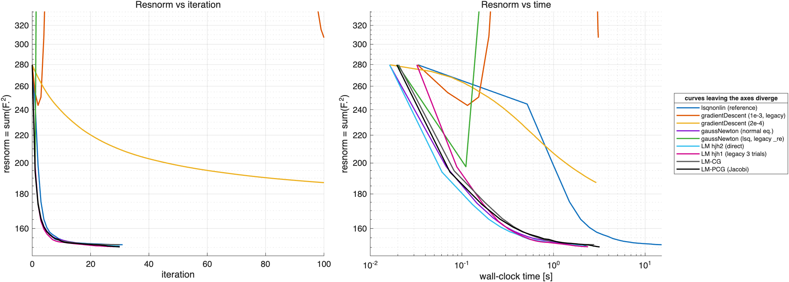
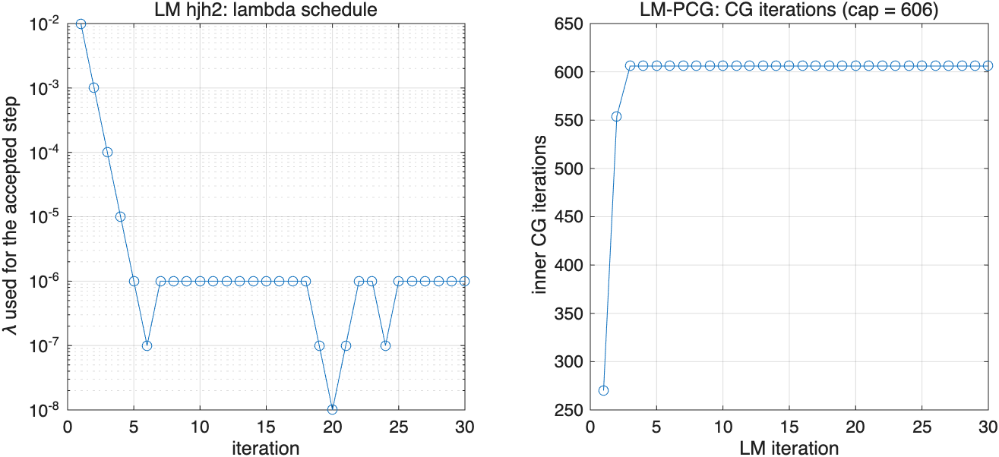

# 5. Solvers / 솔버

[← Checking the Jacobian](04_jacobian_check.md) | [Next: Performance →](06_performance.md)

**Script / 스크립트:** [tutorials/t05_solvers.m](../tutorials/t05_solvers.m)
**Code / 코드:** [+edreg/+solvers/](../+edreg/+solvers/) — [gradientDescent.m](../+edreg/+solvers/gradientDescent.m), [gaussNewton.m](../+edreg/+solvers/gaussNewton.m), [levenbergMarquardt.m](../+edreg/+solvers/levenbergMarquardt.m), [levenbergMarquardtCG.m](../+edreg/+solvers/levenbergMarquardtCG.m)

## Goal / 목표

**EN** — With $F$ and $J$ available, the optimiser itself is a few lines. This chapter replaces `lsqnonlin` with four hand-written methods and compares them on the same problem.

**KO** — $F$와 $J$가 있으면 최적화기 자체는 몇 줄이면 됩니다. 이 장은 `lsqnonlin`을 직접 짠 네 가지 방법으로 바꾸고 같은 문제에서 비교합니다.

## 5.1 Common interface / 공통 인터페이스

```matlab
fun = @(P) edreg.residual(P, model, target, w);     % returns [F, J]
[P, hist] = edreg.solvers.levenbergMarquardt(fun, P0, MaxIterations=30);

hist.resnorm      % cost after each iteration / 반복별 비용
hist.time         % cumulative seconds / 누적 시간
hist.exitReason   % why it stopped / 종료 이유
```

**EN** — Every solver takes a handle returning `[F, J]` and a start point, and returns the final parameters and a history. `fun` recomputes the correspondences on every call, so all methods minimise the same ICP-style cost $E = \lVert F \rVert^2$. All of them start from the gradient $g = 2J^\top F$.

**KO** — 모든 솔버는 `[F, J]`를 반환하는 핸들과 시작점을 받아 최종 파라미터와 이력을 돌려줍니다. `fun`은 호출할 때마다 대응을 다시 계산하므로, 모든 방법이 같은 ICP식 비용 $E = \lVert F \rVert^2$를 최소화합니다. 출발점은 모두 gradient $g = 2J^\top F$입니다.

## 5.2 Gradient descent

$$P \leftarrow P - \alpha  s \odot g$$

**EN** — The simplest method: step against the gradient. $s$ scales the six global parameters by 0.01, because a unit change of the rotation vector moves every vertex by hundreds of millimetres while a unit change of one node translation moves a few vertices by one. Without it the global block dominates and the step size cannot suit both.

The step size $\alpha$ is fixed and there is no line search, so the cost can go up. That is what happens with the original default $\alpha = 10^{-3}$ on this data; $\alpha = 2 \times 10^{-4}$ decreases monotonically but is far from converged after 100 iterations.

**KO** — 가장 단순한 방법으로, gradient 반대 방향으로 이동합니다. $s$는 전역 파라미터 6개에 0.01을 곱합니다. 회전 벡터가 1만큼 변하면 모든 정점이 수백 밀리미터 움직이지만, 노드 이동 하나가 1만큼 변하면 정점 몇 개가 1만큼 움직일 뿐이기 때문입니다. 이 스케일이 없으면 전역 블록이 지배해서 한 스텝 크기로 양쪽을 다 맞출 수 없습니다.

스텝 크기 $\alpha$는 고정이고 line search가 없어서 비용이 올라갈 수 있습니다. 원본 기본값 $\alpha = 10^{-3}$이 이 데이터에서 실제로 그렇습니다. $\alpha = 2 \times 10^{-4}$는 단조 감소하지만 100회 반복 후에도 수렴과는 거리가 멉니다.

## 5.3 Gauss-Newton

$$J^\top J  d = -J^\top F, \qquad P \leftarrow P + d$$

**EN** — Linearise $F(P + d) \approx F + Jd$ and minimise the linearised cost exactly. This uses curvature information and converges in a handful of iterations when it works, but the full step is taken unconditionally.

$J^\top J$ is singular here. The global rotation and translation can also be expressed by the per-node $A_k$, $t_k$, so some directions in parameter space do not change the residual. The solver therefore uses the minimum-norm solution (`lsqminnorm`), as the original script did.

Two ways of computing the step are available, corresponding to two of the original scripts:

- `LinearSolver="normal"` (default): `lsqminnorm(J'*J, -J'*F)`.
- `LinearSolver="lsq"`: `lsqminnorm(J, -F)`.

At the identity the two give the same step: $J$ has exactly six zero singular values there, one per redundant global parameter. After the first step only three stay exactly zero. The other three become tiny but non-zero (about $10^{-4}$, against a largest singular value of 600). `lsqminnorm(J, ...)` treats those as valid directions and divides by them, producing a step 20 times too long, and the iteration diverges. In $J^\top J$ the same values are squared, fall below the rank tolerance and are discarded, so the first form converges.

**KO** — $F(P + d) \approx F + Jd$로 선형화한 뒤 선형화된 비용을 정확히 최소화합니다. 곡률 정보를 쓰므로 잘 될 때는 몇 번 만에 수렴하지만, 전체 스텝을 무조건 받아들입니다.

여기서 $J^\top J$는 특이 행렬입니다. 전역 회전·이동은 노드별 $A_k$, $t_k$로도 표현할 수 있어서, 파라미터 공간에 잔차를 바꾸지 않는 방향이 있습니다. 그래서 원본 스크립트처럼 최소 노름 해(`lsqminnorm`)를 씁니다.

스텝 계산 방식은 두 가지가 있고, 각각 원본 스크립트 두 개에 대응합니다.

- `LinearSolver="normal"` (기본값): `lsqminnorm(J'*J, -J'*F)`.
- `LinearSolver="lsq"`: `lsqminnorm(J, -F)`.

항등 변환에서는 둘이 같은 스텝을 줍니다. 그 점에서 $J$의 특이값 중 정확히 6개가 0이고, 중복되는 전역 파라미터 하나당 하나씩입니다. 첫 스텝 이후에는 3개만 정확히 0으로 남습니다. 나머지 3개는 아주 작지만 0이 아닌 값(최대 특이값 600에 비해 약 $10^{-4}$)이 됩니다. `lsqminnorm(J, ...)`은 이를 유효한 방향으로 보고 그 값으로 나누기 때문에 스텝이 20배 길어지고 반복이 발산합니다. $J^\top J$에서는 같은 값이 제곱되어 랭크 허용오차 아래로 떨어져 버려지므로 첫 번째 형태는 수렴합니다.

## 5.4 Levenberg-Marquardt

$$\bigl(J^\top J + \lambda  \mathrm{diag}(J^\top J)\bigr)  d = -J^\top F$$

**EN** — Damping interpolates between the two previous methods: $\lambda \to 0$ gives Gauss-Newton, large $\lambda$ gives a short, scaled gradient step. It also makes the matrix positive definite, which removes the singularity problem above. The step is accepted only if the cost goes down.

The default schedule (`Variant="hjh2"`) is the one from the original `LM_hjh_2` script:

1. Start with $\lambda = 0.01$.
2. Solve, evaluate the trial point.
3. If the cost dropped, accept. Divide $\lambda$ by 10 only if this was the first trial of the iteration.
4. Otherwise multiply $\lambda$ by 10 and try again. Give up when $\lambda > 10^5$.

The cost therefore never increases. `Variant="hjh1"` reproduces the earlier script (three trials per iteration, the third one taken regardless) for comparison; it can accept uphill steps.

The damped system is solved by sparse Cholesky factorisation. The original code formed a dense inverse.

**KO** — damping은 앞의 두 방법 사이를 보간합니다. $\lambda \to 0$이면 Gauss-Newton이고, $\lambda$가 크면 스케일된 짧은 gradient 스텝입니다. 행렬이 양의 정부호가 되므로 위의 특이성 문제도 사라집니다. 비용이 내려갈 때만 스텝을 받아들입니다.

기본 스케줄(`Variant="hjh2"`)은 원본 `LM_hjh_2` 스크립트의 것입니다.

1. $\lambda = 0.01$에서 시작합니다.
2. 선형계를 풀고 시험점을 평가합니다.
3. 비용이 내려갔으면 받아들입니다. 그 반복의 첫 시도였을 때만 $\lambda$를 10으로 나눕니다.
4. 아니면 $\lambda$에 10을 곱하고 다시 시도합니다. $\lambda > 10^5$이면 포기합니다.

따라서 비용은 절대 올라가지 않습니다. `Variant="hjh1"`은 비교용으로 더 이전 스크립트(반복당 세 번 시도, 세 번째는 무조건 채택)를 재현한 것이고, 비용이 오르는 스텝도 받아들일 수 있습니다.

damping된 선형계는 sparse Cholesky 분해로 풉니다. 원본 코드는 dense 역행렬을 만들었습니다.

## 5.5 Conjugate gradient inside LM / LM 안의 conjugate gradient

```matlab
[P, hist] = edreg.solvers.levenbergMarquardtCG(fun, P0, Preconditioner="jacobi");
```

**EN** — The same LM loop, but the linear system is solved iteratively with conjugate gradient, which needs only products $A p$ and never a factorisation. That matters when the number of nodes is large enough that factorising $J^\top J$ is expensive. `Preconditioner="jacobi"` divides the residual by the diagonal of the damped matrix; `"none"` is plain CG.

With the original tolerance (absolute residual below $10^{-10}$) the inner loop never terminates early on this problem and runs to its cap of 606 iterations in almost every LM step. An absolute tolerance does not suit a right-hand side of this scale; set `CGTolerance` and `CGMaxIterations` for practical use.

**KO** — LM 루프는 같고, 선형계를 conjugate gradient로 반복해서 풉니다. 곱 $A p$만 필요하고 분해는 하지 않습니다. 노드 수가 많아져 $J^\top J$ 분해가 비싸질 때 의미가 있습니다. `Preconditioner="jacobi"`는 잔차를 damping된 행렬의 대각으로 나누고, `"none"`은 일반 CG입니다.

원본 허용오차(절대 잔차 $10^{-10}$ 미만)로는 이 문제에서 내부 루프가 일찍 끝나는 일이 없어서, 거의 모든 LM 스텝에서 상한인 606회까지 돕니다. 절대 허용오차는 이 정도 크기의 우변에는 맞지 않습니다. 실제로 쓸 때는 `CGTolerance`와 `CGMaxIterations`를 지정하세요.

## 5.6 Comparison / 비교

**EN** — Same model (50 nodes, 606 parameters), same weights, identity start with cost 279.68. Times are from one run on an Apple Silicon CPU and vary between runs.

**KO** — 같은 모델(노드 50개, 파라미터 606개), 같은 가중치, 항등 변환에서 시작(비용 279.68)한 결과입니다. 시간은 Apple Silicon CPU에서 한 번 잰 값이고 실행마다 달라집니다.

| Solver | Iterations | Final cost | Time [s] | Mean distance to target [mm] |
|---|---|---|---|---|
| `lsqnonlin` (reference / 기준) | 31 | 151.39 | 15.1 | 9.85 |
| Gradient descent, α = 1e-3 (original default / 원본 기본값) | 100 | 306.88 (rose / 상승) | 3.1 | 15.46 |
| Gradient descent, α = 2e-4 | 100 | 187.10 | 2.9 | 11.19 |
| Gauss-Newton, `normal` | 30 | 150.37 | 2.4 | 9.78 |
| Gauss-Newton, `lsq` | 19 | diverged / 발산 (1.7e16) | 2.4 | — |
| LM `hjh2` (direct) | 30 | 150.72 | 2.3 | 9.79 |
| LM `hjh1` | 30 | 150.33 | 2.4 | 9.80 |
| LM-CG | 30 | 151.42 | 2.8 | 9.83 |
| LM-PCG (Jacobi) | 30 | 150.25 | 3.2 | 9.78 |

**EN** — Distance before registration: 13.82 mm mean. The full table, including function-evaluation counts and exit reasons, is written to `results/t05_summary.md`.

**KO** — 정합 전 평균 거리는 13.82 mm입니다. 함수 평가 횟수와 종료 이유까지 담은 전체 표는 `results/t05_summary.md`에 저장됩니다.



**EN** — What to take from it:

- All Newton-type methods reach the same cost, about 150, within 30 iterations. They differ in robustness, not in the answer.
- Gradient descent needs a hand-tuned step, and after 100 iterations it is still at 187 where the others reach 150 in 30.
- Gauss-Newton without damping works here in one formulation and diverges in the other. LM costs the same per iteration and has no such fragility.
- The hand-written LM takes about 2.3 s against 15 s for `lsqnonlin` with the same number of iterations on this problem size.

**KO** — 정리하면:

- Newton 계열 방법은 모두 30회 안에 같은 비용(약 150)에 도달합니다. 차이는 답이 아니라 안정성에 있습니다.
- gradient descent는 스텝을 손으로 맞춰야 하고, 100회 반복 후에도 187에 머뭅니다. 다른 방법은 30회에 150에 도달합니다.
- damping 없는 Gauss-Newton은 한 가지 형태에서는 동작하고 다른 형태에서는 발산합니다. LM은 반복당 비용이 같으면서 이런 취약함이 없습니다.
- 이 문제 크기에서 같은 반복 횟수일 때 직접 짠 LM은 약 2.3초, `lsqnonlin`은 15초가 걸립니다.



## Run / 실행

```matlab
run('tutorials/t05_solvers.m')
```

[Next: Performance / 다음: 성능 →](06_performance.md)
