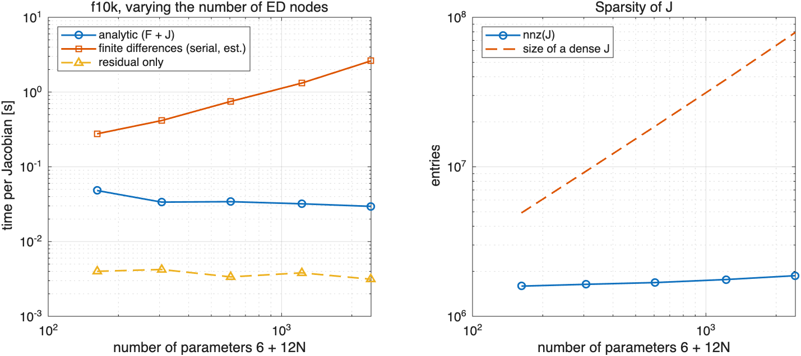

# 6. Performance / 성능

[← Solvers](05_solvers.md) | [README](../README.md)

**Script / 스크립트:** [tutorials/t06_performance.m](../tutorials/t06_performance.m)

## Goal / 목표

**EN** — Quantify what the analytic Jacobian saves, and how the saving changes with mesh size and node count.

**KO** — 해석적 Jacobian으로 얼마나 절약되는지, 그리고 메쉬 크기와 노드 수에 따라 그 차이가 어떻게 변하는지 수치로 확인합니다.

## 6.1 One Jacobian / Jacobian 한 번의 비용

**EN** — Three ways to get $J$ for the sample pair (5,027 vertices, 50 nodes, 606 parameters):

**KO** — 샘플 쌍(정점 5,027개, 노드 50개, 파라미터 606개)에서 $J$를 구하는 세 가지 방법입니다.

| Method / 방법 | Time [s] | Relative / 배수 |
|---|---|---|
| Residual only / 잔차만 | 0.003 | 0.08 |
| Analytic residual + Jacobian / 해석적 잔차 + Jacobian | 0.042 | 1 |
| Finite differences, serial / 유한차분, 직렬 (606 evaluations) | 0.71 | 17 |
| Finite differences, `parfor` / 유한차분, `parfor` (10 workers) | 0.35 | 8 |

**EN** — A finite-difference Jacobian evaluates the residual once per parameter. `parfor` over the columns, which is what the original scripts did, divides that by roughly the number of workers but does not change how it scales. The analytic Jacobian costs about as much as a dozen residual evaluations, independent of the number of parameters.

**KO** — 유한차분 Jacobian은 파라미터마다 잔차를 한 번씩 계산합니다. 원본 스크립트처럼 열에 대해 `parfor`를 돌리면 대략 워커 수만큼 줄어들지만 증가 양상은 바뀌지 않습니다. 해석적 Jacobian은 파라미터 수와 무관하게 잔차 계산 열두어 번 정도의 비용입니다.

## 6.2 Scaling / 규모에 따른 변화

**EN** — Mesh size, at the default 1% node sampling:

**KO** — 메쉬 크기에 따른 변화입니다(노드 샘플링은 기본값 1%).

| Mesh | Vertices | Nodes | Parameters | nnz(J) | Fill | Analytic [s] | Finite diff. [s] (estimated / 추정) | Ratio / 배수 |
|---|---|---|---|---|---|---|---|---|
| f10k | 5,027 | 50 | 606 | 1.68M | 9.0% | 0.037 | 0.86 | 23 |
| f20k | 10,038 | 100 | 1,206 | 3.39M | 4.6% | 0.066 | 3.0 | 46 |

**EN** — Finite-difference times in this section are extrapolated from timing 20 columns. Doubling the mesh doubles the analytic cost and more than triples the finite-difference cost, because both the cost of one residual and the number of columns grow.

**KO** — 이 절의 유한차분 시간은 20개 열을 재서 전체로 환산한 추정값입니다. 메쉬가 두 배가 되면 해석적 비용은 두 배가 되고 유한차분 비용은 세 배 넘게 늘어납니다. 잔차 한 번의 비용과 열 수가 함께 늘기 때문입니다.

**EN** — Number of nodes, on the f10k mesh:

**KO** — f10k 메쉬에서 노드 수에 따른 변화입니다.

| Nodes | Parameters | nnz(J) | Fill | Analytic [s] | Finite diff. [s] (estimated / 추정) | Ratio / 배수 |
|---|---|---|---|---|---|---|
| 13 | 162 | 1.59M | 32.4% | 0.048 | 0.28 | 6 |
| 25 | 306 | 1.64M | 17.5% | 0.034 | 0.42 | 12 |
| 50 | 606 | 1.68M | 9.0% | 0.034 | 0.75 | 22 |
| 101 | 1,218 | 1.76M | 4.6% | 0.032 | 1.32 | 41 |
| 201 | 2,418 | 1.87M | 2.4% | 0.030 | 2.62 | 89 |



**EN** — The finite-difference cost grows linearly with the number of parameters; the analytic cost stays flat. The reason is on the right: the number of non-zeros of $J$ hardly changes when nodes are added, because each vertex is still influenced by $K = 4$ nodes. Only the number of columns grows, so $J$ gets sparser (fill falls from 32% with 13 nodes to 2.4% with 201).

The more nodes the deformation needs, the more the analytic Jacobian is worth. Detailed deformation of a human body needs many more than 50 nodes.

**KO** — 유한차분 비용은 파라미터 수에 비례해 늘고, 해석적 비용은 일정합니다. 이유는 오른쪽 그림에 있습니다. 노드를 늘려도 $J$의 non-zero 개수는 거의 변하지 않습니다. 정점 하나는 여전히 노드 $K = 4$개의 영향만 받기 때문입니다. 열 수만 늘어나므로 $J$는 더 sparse해집니다(채움 비율이 노드 13개일 때 32%에서 201개일 때 2.4%로 떨어집니다).

변형에 필요한 노드가 많을수록 해석적 Jacobian의 가치가 커집니다. 사람 몸의 세밀한 변형에는 50개보다 훨씬 많은 노드가 필요합니다.

## 6.3 Larger data / 더 큰 데이터

**EN** — The script also has an 80k-face case, which the original experiments used. Those meshes are not in the repository; the case is skipped unless `data/human_020_f80k.ply` and `data/human_022_f80k.ply` exist.

Nothing larger than the f20k pair (about 10,000 vertices) has been run with this code. The step to watch at larger sizes is `buildModel`, which computes a shortest-path search from every node over the whole mesh. The original GPU path was dropped in the refactor; nothing here was measured on a GPU.

**KO** — 스크립트에는 원래 실험에서 쓴 face 8만 개짜리 경우도 들어 있습니다. 이 메쉬는 저장소에 없으므로 `data/human_020_f80k.ply`, `data/human_022_f80k.ply`가 있을 때만 실행하고 없으면 건너뜁니다.

이 코드로 f20k 쌍(정점 약 1만 개)보다 큰 데이터는 돌려 보지 않았습니다. 더 큰 규모에서 눈여겨볼 단계는 `buildModel`로, 모든 노드에서 메쉬 전체에 대해 최단 경로 탐색을 합니다. 원본의 GPU 경로는 정리 과정에서 제거했고, 여기 수치 중 GPU에서 측정한 것은 없습니다.

## Run / 실행

```matlab
run('tutorials/t06_performance.m')
```

[Back to README / README로 →](../README.md)
